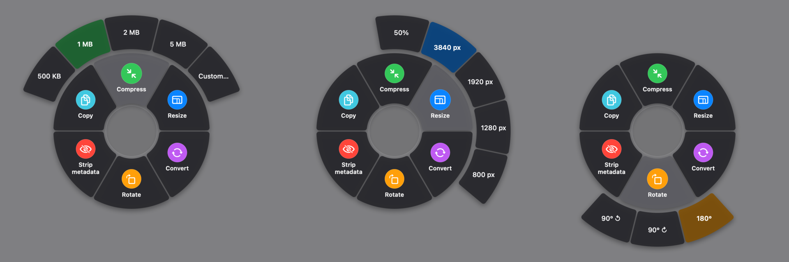
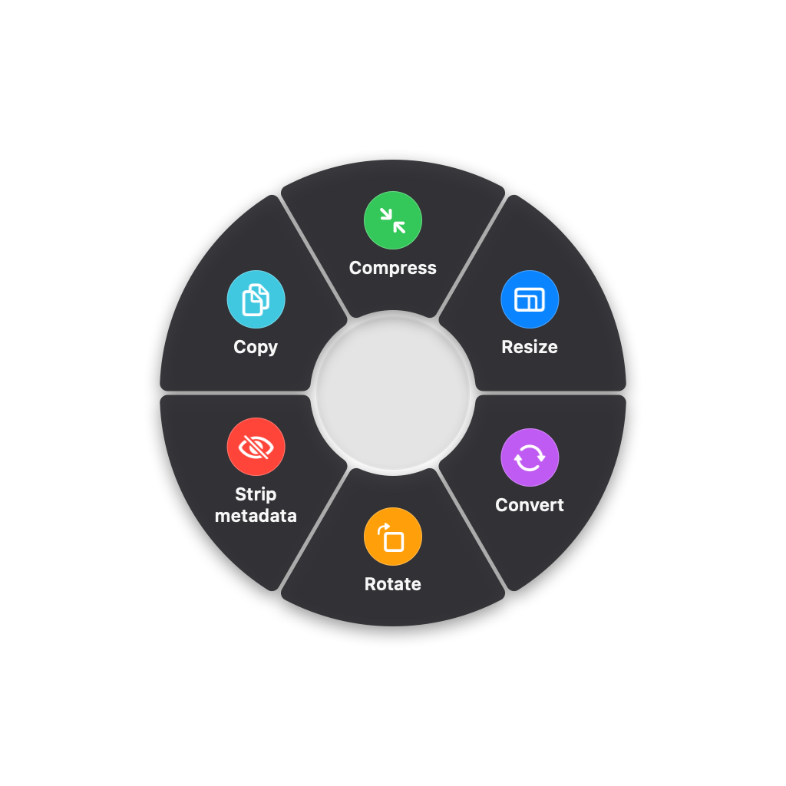
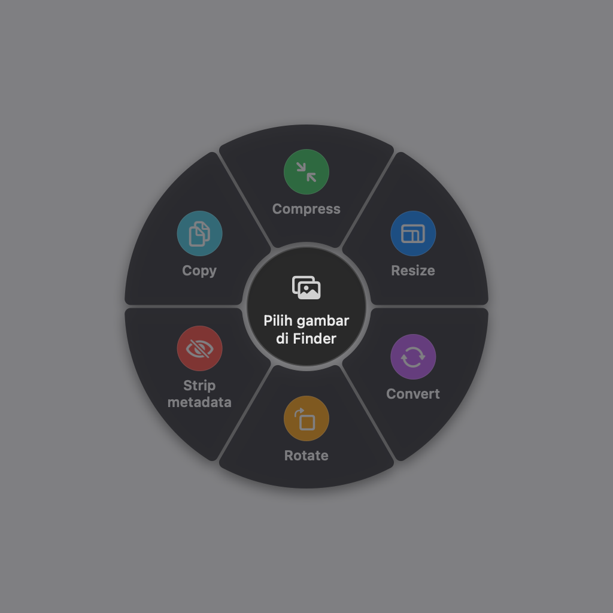

# ImageRing

A radial menu for images in Finder. Select images, hold **⌃⌥Space**, flick the mouse toward an action, release.



## What it does

| Action | Options | Output (next to the original) |
|---|---|---|
| Compress | 500 KB · 1 MB · 2 MB · 5 MB · Custom… | `photo-1MB.jpg`, always under the target size |
| Resize (long edge) | 50% · 3840 · 1920 · 1280 · 800 px | `photo-1920px.jpg` |
| Convert | JPG · PNG · HEIC · WebP* | `photo.png` |
| Rotate | 90° ↺ · 90° ↻ · 180° | `photo-rot90.jpg` |
| Strip metadata | removes EXIF, GPS, camera info | `photo-clean.jpg` |
| Copy | copies the image to the clipboard | — |

Originals are never modified. Name collisions get `-2`, `-3`, …
Works on several selected files at once. A notification shows the result.

\* WebP needs `cwebp` from Homebrew (`brew install webp`).

Compress works by binary-searching JPEG quality (60–92) and only lowers the resolution when quality alone can't reach the target, so images stay sharp. 1 MB = 1,000,000 bytes, the same unit Finder shows.

## Install

1. Download `ImageRing-x.y.dmg` from [Releases](../../releases) and drag **ImageRing** to **Applications**.
2. Open it. The app is ad-hoc signed (not notarized), so the first time macOS blocks it:
   **System Settings → Privacy & Security → "ImageRing was blocked" → Open Anyway**.
   Or in Terminal:
   ```bash
   xattr -dr com.apple.quarantine /Applications/ImageRing.app
   ```
3. On first use, allow **"ImageRing wants to control Finder"** — it only reads the current selection.
4. Optional: start at login via **System Settings → General → Login Items → +**.

A ◎ icon in the menu bar means it is running (Quit is there too).
Requires macOS 13 or later, Apple Silicon or Intel.

## Using it

- **Hold** ⌃⌥Space, move toward a slice (submenus open on the outer arc), **release** to run.
- **Tap** ⌃⌥Space to keep the ring open, then click.
- Esc, the centre, or a click outside cancels.

<p>
  
  
</p>

## Build from source

Command Line Tools are enough (no Xcode needed).

```bash
./build.sh                 # build/ImageRing.app (universal, ad-hoc signed)
bash test/run_tests.sh     # headless tests for every action
bash design/geometry_test.sh
scripts/make-dmg.sh        # dist/ImageRing-<version>.dmg
```

Debug flags: `--demo` (show the ring without the hotkey), `--render <state> out.png`, `--run <action-id> files…`, `--selftest`.

Layout: `Sources/` (app), `scripts/img-shrink` (size-target compressor, bundled in the app), `design/DESIGN.md` (ring geometry, colours, states).

## License

MIT
